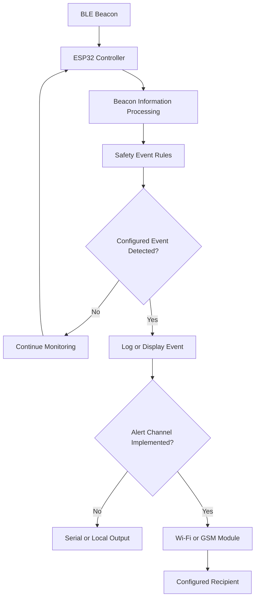

# System Architecture

## 1. Purpose

This document describes the proposed architecture of the Smart School Transport Safety and Monitoring System.

The system is based on an ESP32 controller that receives or scans for BLE beacon information, evaluates configured conditions, and produces monitoring output. Alert communication is optional and depends on the hardware and firmware implemented.

## 2. Main Components

### ESP32 Controller
The ESP32 acts as the main controller. It runs the firmware, processes beacon information, and evaluates configured event conditions.

### BLE Beacon
A BLE beacon broadcasts Bluetooth Low Energy advertisements. The ESP32 can scan for these advertisements and identify a configured beacon when the required information is available.

### Safety Event Processing
The firmware evaluates the received information against defined rules. For example, a rule may identify that an expected beacon has not been detected within a configured time.

### Alert Output
The prototype may report events through the Serial Monitor. If a communication module or network connection is implemented, the system may also send notifications through the configured channel.

### Optional Sensors
An IR sensor or another sensor may be included if it is part of the actual hardware design. Its input and role must be documented according to the implemented circuit.

## 3. Data Flow

1. The BLE beacon broadcasts advertisements.
2. The ESP32 scans for available BLE advertisements.
3. The firmware checks the received beacon information.
4. The event-processing logic evaluates the configured rules.
5. The system records or displays the resulting event.
6. If alert communication is implemented and available, the system attempts to send the configured alert.

## 4. Proposed Architecture Diagram

This diagram shows the proposed design. It does not confirm that every block has already been implemented.

## 5. Communication

### BLE
BLE is used for short-range beacon discovery. Detection depends on beacon advertisements, receiver settings, distance, and environmental conditions.

### Wi-Fi
Wi-Fi may be used to transfer events to a server or notification service if the firmware and destination are implemented.

### GSM
A GSM module may be used for cellular notifications if the module, SIM, network service, and message-sending firmware are configured.

Use only the communication option that is actually present in the prototype.

## 6. Failure Conditions

The system should be evaluated for the following conditions:

- Expected beacon is not detected.
- Beacon signal becomes intermittent.
- ESP32 restarts or loses power.
- Wi-Fi or GSM communication is unavailable.
- The same event is detected repeatedly.
- Invalid or unexpected beacon information is received.

The firmware should handle these conditions predictably and make failures visible during testing.

## 7. Security and Privacy

- Do not store credentials directly in public source files.
- Do not expose personal information in event logs.
- Avoid publishing real-time transport data.
- Use simulated information for public demonstrations where possible.
- Restrict access to any alert destination or server that stores personal data.

## 8. Design Limitations

BLE beacon detection cannot independently verify passenger identity, passenger count, driver behaviour, or overall vehicle safety. The system is an assistance tool and requires further testing before any real-world deployment.
